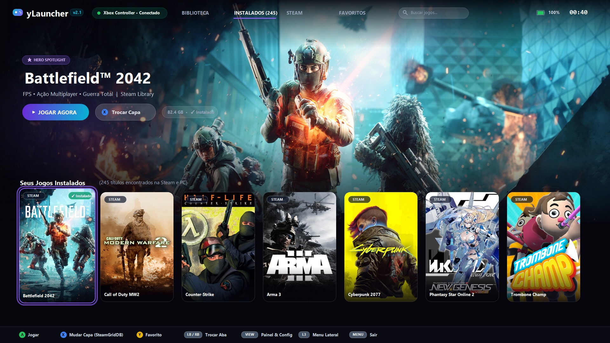

# yLauncher

<div align="center">

**A modern, lightweight, console-style game launcher for Windows — built for mouse, keyboard, and gamepad.**

[](https://www.microsoft.com/windows)
[](CHANGELOG.md)
[](#controller-navigation)
[](#project-status)

[**Download Installer (v2.1)**](Instalador_yLauncher_v2.1.exe) &middot; [**Download Portable ZIP**](yLauncher_v2.1_Portable.zip) &middot; [View Changelog](CHANGELOG.md)

<br/>



</div>

---

## Overview

**yLauncher** is a lean, fast, full-screen gaming frontend designed to turn your Windows PC, TV setup, or gaming handheld into a dedicated gaming console. It organizes all your games from multiple stores and platforms into a single, cohesive, distraction-free interface.

Unlike bulky desktop clients, yLauncher launches in milliseconds, consumes minimal background resources, requires no mandatory accounts or cloud login, and offers native, console-quality gamepad navigation out of the box.

Optimized for desktop displays and handheld devices including **Lenovo Legion Go**, **ASUS ROG Ally**, **Steam Deck (Windows)**, **AYANEO**, **GPD**, and **OneXPlayer**.

---

## What's New in v2.1.2

- **Full Multilingual Localization (English, Portuguese, Russian)**:
  - Complete native and UI translations for English (EN), Portuguese (PT), and Russian (RU).
  - Quick-switch language selector in the Settings Hub with immediate persistence.
  - Native installer, uninstaller, and Windows system dialogs detect and adapt to your OS display language.
- **Background Input Lock & Focus Guard**:
  - Automatically suppresses gamepad and keyboard inputs when yLauncher loses focus or when another application/game is active.
  - Automatically minimizes launcher window when games start and restores focus on exit.
  - HUD paused status pill (`🔒 Paused`) indicating active background protection.
- **SteamGridDB Background & Banner Downloader**: Search, download, and apply high-resolution widescreen backgrounds (1920x620 heroes and 16:9 banners) directly inside the app.
- **Dual Art Studio Targets**: Seamlessly toggle between **Vertical Covers (600x900)** and **Widescreen Backgrounds**.
- **Enhanced Gamepad Art Studio Controls**:
  - D-Pad / Analog sticks navigate a 2D gallery grid with adaptive column counts (2 columns for widescreen heroes, 4 columns for vertical covers).
  - Pressing **(A)** on a selected artwork confirms and applies it immediately.
  - Pressing **(X)** or **START** applies the artwork instantly.
  - Pressing **(Y)** opens fullscreen HD Lightbox zoom.
  - Pressing **(LT) / (RT)** toggles between Cover and Background modes instantly.
  - Pressing **(LB) / (RB)** flips through gallery pages.
- **Improved Security & Performance**: Tokenized local HTTP bridge, sandboxed SteamGridDB proxy, 5 MB image size validation, and optimized memory usage.

---

## Key Features

- **Console-Grade Fullscreen Experience**: Fluid horizontal game carousel with smooth scaling, dynamic high-res backdrop art, dark mode aesthetics, and digital clock telemetry.
- **Native Controller Support**: Full XInput and DirectInput support with deadzone hysteresis, eliminating stick drift and accidental multi-jumps.
- **SteamGridDB Integration**: Automatic cover and hero art suggestions with intelligent title matching and franchise disambiguation chips.
- **Multi-Store Library Detection**: Auto-detects installed games across **Steam**, **Epic Games**, **Battle.net**, and **EA App** without manual path configuration.
- **Custom & Local Games**: Easily add standalone `.exe`, `.bat`, `.lnk` files, emulated games, or ROMs with integrated file browser and launch testing.
- **Gamer Stats & Telemetry**: Track hours played, session counts, personal 1-to-5 star ratings, backlog status (*Backlog*, *Playing*, *Completed*, *100% Platinado*), and notes.
- **Gamer Roulette ("What to play today?")**: Built-in wheel spinner to pick a random game from your library when you can't decide.
- **Privacy & Security**: Zero telemetry tracking, no mandatory cloud accounts, and a secured local native bridge.

---

## Controller Navigation

### In the Main Library:

| Button | Action |
| :--- | :--- |
| **D-Pad / Left Stick** | Navigate game carousel / grid |
| **(A) / Enter** | Launch selected game |
| **(B) / Esc** | Back / Clear search / View all |
| **(X) / START** | Customize game artwork (Cover / Background) |
| **(Y)** | Toggle Favorite |
| **(LB) / (RB)** | Switch category tabs (Installed, All, Recent, Favorites, Custom) |
| **(View / Select)** | Open Settings Hub & Customization |
| **(L3)** | Toggle quick sidebar |

### In the Artwork Studio:

| Button | Action |
| :--- | :--- |
| **D-Pad / Left Stick** | Navigate artwork cards (2 columns for Heroes, 4 columns for Covers) |
| **(A)** | Select & Preview; press again to **Apply** and close |
| **(X) / START** | **Apply** the focused artwork immediately |
| **(Y)** | Open fullscreen HD Lightbox Zoom |
| **(LT) / (RT)** | **Toggle between Cover (600x900) and Background (Widescreen)** |
| **(LB) / (RB)** | Previous / Next page of artworks |
| **(B)** | Close Studio |

---

## Installation

### Option 1: Installer (Recommended)
1. Download the [v2.1 Installer](Instalador_yLauncher_v2.1.exe).
2. *(Optional)* Verify the SHA-256 hash in the [Integrity](#integrity) section below.
3. Run the installer and choose your installation path and shortcuts.
4. Click **Install**. Existing libraries and settings are safely preserved during updates.

### Option 2: Portable Edition
1. Download the [v2.1 Portable ZIP](yLauncher_v2.1_Portable.zip).
2. Extract the archive into any folder of your choice.
3. Run `yLauncher.exe` directly. No registry installation required.

> **Note**: Because yLauncher is an independent open-source release without an expensive EV code signing certificate, Windows Defender SmartScreen may display an alert on first run. Click *"More info"* and *"Run anyway"*. You can always verify the binary checksums below.

---

## System Requirements

- **Operating System**: Windows 10 (version 1809 or later) or Windows 11 (64-bit / 32-bit).
- **Web Engine**: Microsoft Edge (preinstalled on modern Windows) for runtime web rendering.
- **Controller**: Any Xbox / XInput compatible controller, PlayStation controller via standard driver, or handheld gamepad. Mouse and keyboard are fully supported.
- **Network**: Internet connection required only for downloading SteamGridDB covers and banners.

---

## Integrity & Checksums

Official SHA-256 hashes are also published in [checksums.sha256](checksums.sha256):

| File | SHA-256 Hash |
| :--- | :--- |
| `Instalador_yLauncher_v2.1.exe` | `5B4EB55B691586E386A470F4F12BDFC9FEAD3525F18263706F3CD8730952F97C` |
| `yLauncher_v2.1_Portable.zip` | `36FD44B956B956F6CC63B5829041CE384C86CB7A7EAEE321DE38B919364A0092` |

To verify on PowerShell:

```powershell
Get-FileHash .\Instalador_yLauncher_v2.1.exe -Algorithm SHA256
Get-FileHash .\yLauncher_v2.1_Portable.zip -Algorithm SHA256
```

---

## Building from Source

The complete source code is included in `src/`. With the Visual Studio 2022 Build Tools (or Visual Studio Community) and C# compiler installed, run:

```powershell
powershell.exe -NoProfile -ExecutionPolicy Bypass -File .\build.ps1
```

The script compiles the runtime launcher, uninstaller, and self-extracting installer, verifies embedded manifest resources and versions, and outputs release packages to `dist/`.

```text
src/
├── runtime/       # Native C# runtime launcher & local HTTP bridge
├── installer/     # HTML5/CSS3/JS user interface & embedded installer
└── uninstaller/   # Safe uninstaller with /purge support
```

---

## Project Status

yLauncher is in active **Beta** development. If you encounter an issue or have a feature suggestion, please [open an issue](https://github.com/kromossomom-debug/yLauncher/issues) with your Windows build and steps to reproduce.

---

<div align="center">
<sub>Play more, configure less. Crafted for the PC & Handheld gaming community.</sub>
</div>
